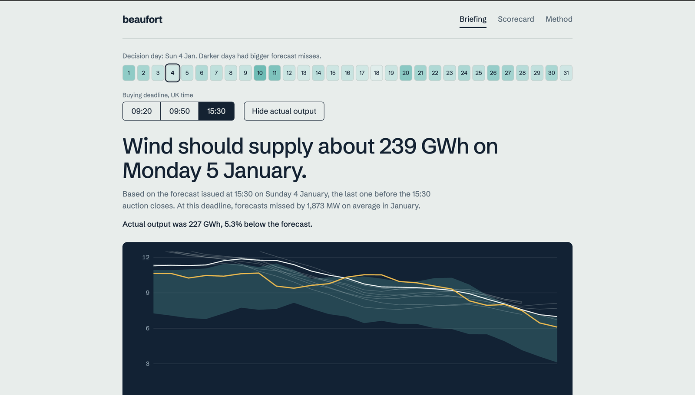
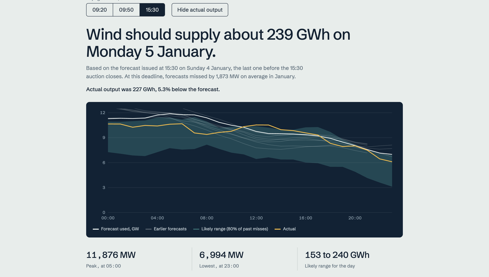

# Beaufort

**Wind forecast briefing and scorecard for a day-ahead power buyer.**

Live app: _add link here_

A UK electricity supplier buys tomorrow's power today, before it knows how much wind will blow. Beaufort answers two questions using Elexon's public data:

1. How much wind power should I expect tomorrow, using only what I could have known when I had to buy?
2. How far can I trust that forecast?

Scope: purchase decisions made on 1 to 31 January 2026, which means delivery days 2 January to 1 February 2026.



## What it does

- **Briefing.** Pick a decision day and a buying deadline. It shows the wind forecast the buyer could actually have seen, the earlier forecasts it replaced, and a likely range based on how far past forecasts missed. One button reveals what actually happened, and an input estimates how much power to buy from other sources.
- **Scorecard.** January forecast accuracy: average miss, large-miss-weighted error, bias, and error as a share of average output. Hovering a bar shows that day's (or hour's) miss and whether the forecast was too high or too low. Clicking a day opens its briefing.
- **Method.** A plain-language page that explains how every number is made.



*The white line is the forecast used. The faint lines are earlier forecasts. The teal band is the likely range, and the yellow line is what actually happened.*

## How the numbers are made

1. **Decision rule.** Power for a delivery day is bought the day before, at a GB day-ahead auction. The three closes are 09:20 (EPEX hourly), 09:50 (N2EX hourly) and 15:30 (EPEX half-hourly), UK time. For every hour of the delivery day, the app uses the newest `WINDFOR` forecast published at or before the chosen deadline. Later forecasts are ignored, because the buyer could not have seen them.
2. **Actuals.** Actual wind output comes from `FUELHH`. It is half-hourly, so it is averaged to the forecast's hourly resolution.
3. **Miss.** Actual minus forecast. A negative number means the forecast was too high.
4. **Likely range.** For each hour of the day, the 10th and 90th percentile of past misses are added to the forecast, so about 80% of January outcomes fall inside the band.
5. **Metrics.** Mean absolute error, root mean square error (weights large misses more), bias (mean miss), and mean absolute error as a percentage of average actual output.

In January UK time equals UTC, so there are no daylight-saving edge cases.

## Results, January 2026

- At the 15:30 deadline the forecast missed by about 1.9 GW on average (16.6% of average output). At 09:20 it missed by about 2.0 GW.
- At every deadline the forecast ran about 1.7 GW above actual output on average. The gap is mostly a steady offset, not random noise. I have not investigated the cause, and the app reports it as it is without correcting it. One possibility is that the two datasets do not cover exactly the same wind.

## Files and directories

```
.
├── backend/
│   ├── fetch_data.py       Downloads and filters the Elexon data into backend/data/
│   ├── logic.py            The decision rule: latest forecast published before the deadline
│   ├── test_logic.py       Unit tests for the decision rule
│   ├── main.py             FastAPI app: /api/briefing, /api/accuracy, and serves the UI
│   ├── requirements.txt    Python dependencies
│   └── data/               Snapshot of the January 2026 data (committed on purpose)
├── frontend/               React (Vite) single-page app
│   ├── index.html
│   ├── package.json
│   ├── vite.config.js      Proxies /api to the backend in dev mode
│   └── src/
│       ├── App.jsx         All screens, plus the hand-drawn SVG chart and bar charts
│       ├── main.jsx
│       └── styles.css
├── docs/                   Screenshots used in this README
├── Dockerfile              Builds the UI, then serves UI and API from one Python image
├── heroku.yml              Tells Heroku to build from the Dockerfile
└── README.md
```

## How to start the application

### With Docker (recommended)

```bash
git clone <this repo>
cd <this repo>
docker build -t beaufort .
docker run -p 8000:8000 beaufort
```

Open http://localhost:8000. The data snapshot is already in the repo, so no API calls are needed.

### Without Docker

```bash
# terminal 1: API on port 8000
cd backend
pip install -r requirements.txt
uvicorn main:app --port 8000

# terminal 2: UI with hot reload
cd frontend
npm install
npm run dev
```

Open the address Vite prints, usually http://localhost:5173.

### Refresh the data (optional)

```bash
cd backend
pip install -r requirements.txt
python fetch_data.py
```

This pulls `FUELHH` and `WINDFOR` from the Elexon Insights API and rewrites `backend/data/`. It needs internet access and takes a few minutes.

### Run the tests

```bash
cd backend
pip install pytest
pytest
```

The tests check that the forecast used is the newest one published before the deadline, and never a later one.

## Deployment

Deployed on Heroku using the container stack.

Live app: _add link here_

```bash
heroku create
heroku stack:set container
git push heroku main
```

The data snapshot ships inside the image, so the live app never depends on the Elexon API being available.

## API

- `GET /api/briefing?day=2026-01-09&cut=09:20` returns the hourly forecast for the day after `day`, the likely range, earlier forecasts, and actual output where known.
- `GET /api/accuracy?cut=09:20` returns the January error metrics, plus the average miss and bias by delivery day and by hour.

`cut` is one of `09:20`, `09:50` or `15:30`.

## Design decisions

- **One container.** FastAPI serves the built React app and the API, so there is one image to run and one thing to deploy.
- **Committed data snapshot.** The scope is a fixed past month, so the data is fetched once. The app starts instantly and works offline.
- **Decision rule in its own module.** `logic.py` is the one piece of logic that matters, so it is isolated and unit tested.
- **No chart library.** Charts are plain SVG. This keeps the bundle small and gives full control over the hover and animation behaviour.
- **No login.** Nothing here is private, and a login would only get in the way of reviewers.

## Limitations and next steps

- The likely range is built from the same month it is judged on, so it describes what happened. It is not an out-of-sample promise.
- Demand is not in the dataset, so the "what to buy" figure uses a flat number entered by the user.
- Only January 2026 is covered, at hourly resolution.
- Next: a breakdown of error by wind level, an out-of-sample range, API tests, and continuous integration.

## AI use

This project was built with AI assistance. Claude (by Anthropic) helped write the code, the design and this README. I ran the app, checked the results and made the decisions about scope and presentation.
